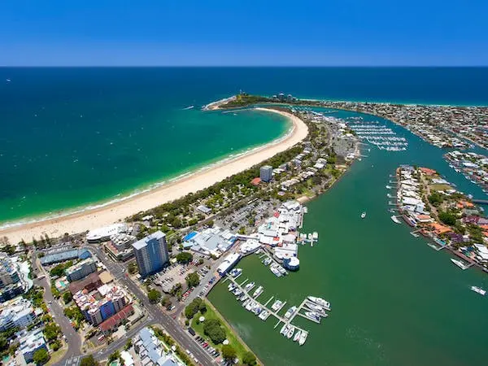

AASC2026 is being held at the Mantra Mooloolabam, located at 7 Venning St, Mooloolaba.

## **Travel from Sunshine Coast Airport to Mantra Mooloolaba Beach**

*Taxis & Uber:* The journey from the Sunshine Coast Airport to Mantra Mooloolaba Beach is approximately 13km, with an approximate fare of \$60.

*Public Transport:* Buses regularly service the Sunshine Coast Airport, with the trip between the airport and Mantra Mooloolaba Beach estimated to take at least 45min and involve changing buses at least once. Bus fares in South-East Queensland are all 50c.

Direct flights to and from the Sunshine Coast are available via Sydney, Melbourne, Adelaide, Cairns, and Auckland.

## **Travel from Brisbane Airport (Domestic & International) to Mantra Mooloolaba Beach**

*Car*: The journey between Brisbane Airport and Mantra Mooloolaba Beach is approximately 100km, with an estimated travel time of 90min. Allow for longer in peak travel times.

*Public Transport:* Allow at least 2.75 hours, noting that [multiple changes between trains and buses are required](https://www.google.com/maps/dir/Brisbane+Airport+Domestic+Terminal+Multi-Storey+Car+Park,+Brisbane+Airport+QLD/Mantra+Mooloolaba+Beach,+7+Venning+St,+Mooloolaba+QLD+4557/@-27.3881848,153.1227879,15.42z/data=!4m15!4m14!1m5!1m1!1s0x6b93e1f08ba49da1:0xfda54ebdb9c05e68!2m2!1d153.1176714!2d-27.384062!1m5!1m1!1s0x6b9375dd88c0a8eb:0x9163d53e42bb1eb1!2m2!1d153.1170479!2d-26.6786405!3e3!5i1?entry=ttu&g_ep=EgoyMDI2MDEwNy4wIKXMDSoASAFQAw%3D%3D). Train and bus fares in South-East Queensland are all 50c, with the exception of the [Airtrain](https://www.airtrain.com.au/) (included in any journey departing from/ending at Brisbane Airport).
